# Owlook

<picture>
  <source media="(prefers-color-scheme: dark)" srcset="docs/owlook-logo-dark.png">
  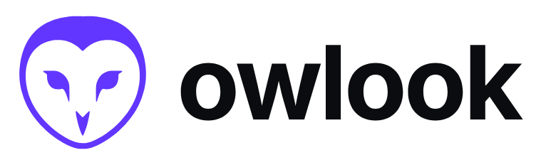
</picture>

**Market quotes always in view while you browse.** Owlook is a free browser extension that puts a small glass panel on top of any web page, with watchlists, a portfolio, candlestick and price-history charts, important news, and the US economic and earnings calendars.

> **Beta.** Owlook is new and still being tested. Things may break, data sources may change, and features may move around between versions. Bug reports are very welcome (see [Feedback](#feedback)).

**⬇️ [Add to Chrome from the Chrome Web Store](https://chromewebstore.google.com/detail/eejkikdiikidddfdpeejelhfcfhieelp)** · Website: <https://owlook-quotes.github.io/owlook/> (Chrome, Edge, Brave, Opera, Vivaldi, Arc)

*Versione italiana più sotto ([vai](#italiano)).*

<p align="center">
  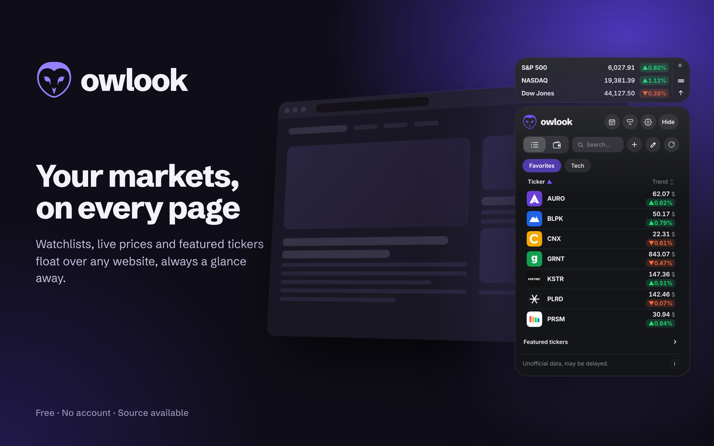
</p>
<p align="center">
  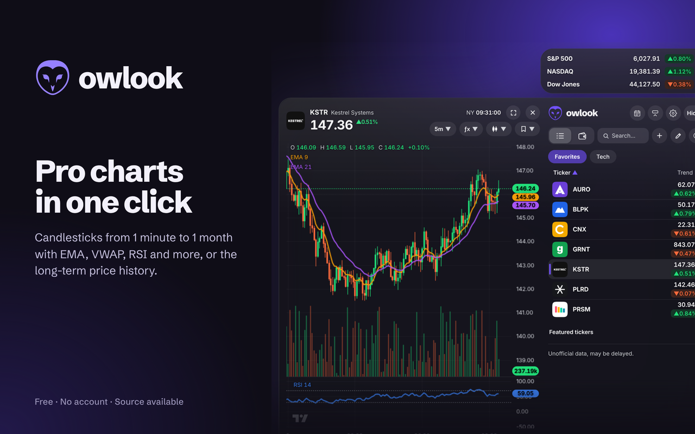
  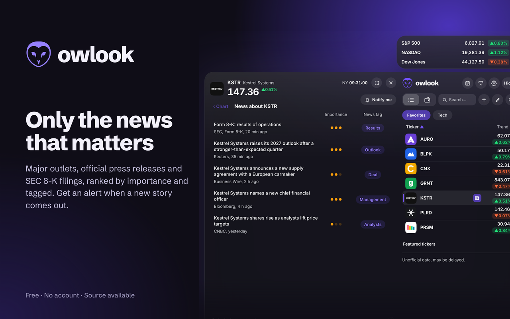
</p>
<p align="center">
  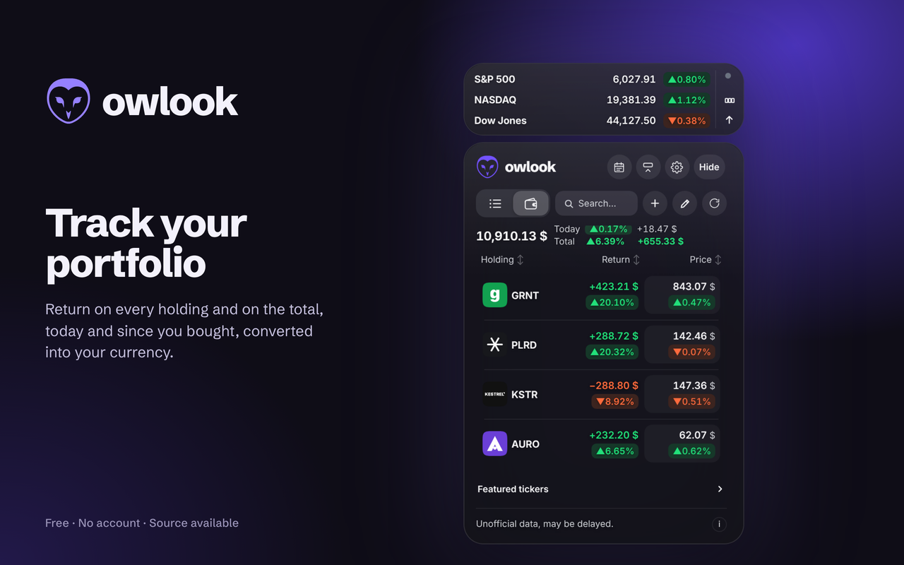
  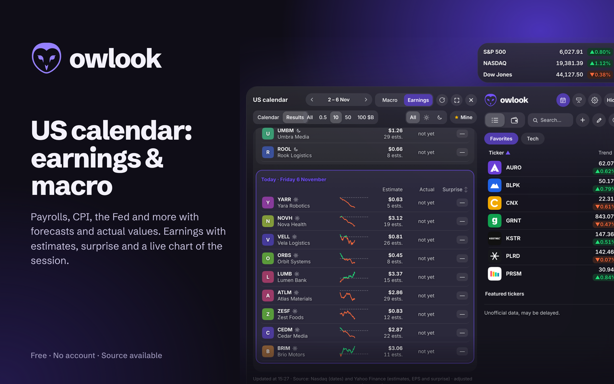
</p>
<p align="center">
  <a href="https://owlook-quotes.github.io/owlook/">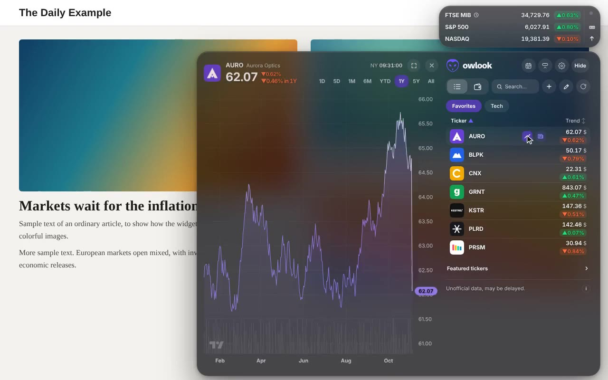</a><br>
  <sub>▶ Watch Owlook in action on the <a href="https://owlook-quotes.github.io/owlook/">website</a>.</sub>
</p>

<sub>Images made with demo tickers, logos and data.</sub>

## Features

- **Watchlists**: several lists with ticker and logo, live prices, change since the last close and today's change (after-hours included when the market is closed), sorting, drag to reorder.
- **Portfolio**: quantity, average cost, return, value and share of the total, with currency conversion.
- **Charts**: candlesticks with indicators (EMA, RSI and more), several chart types, and a long-term price-history chart. Zoom and position are remembered, and you can save chart setups (indicators, colors, interval) under a name.
- **US economic calendar**: payrolls, CPI, GDP, Fed decisions… with analysts' forecasts.
- **US earnings calendar**: the week at a glance with the logos of the companies reporting before the open and after the close, market-cap filters, and for each company the EPS estimate, actual EPS and surprise, with a results view and a live marker for companies reporting now.
- **News (important only)**: in every row of the list (on mouse over), next to the price-history button, a newspaper button shows the important stories about that ticker: major agencies and outlets (Reuters, AP, Bloomberg, WSJ, CNBC…), official company press releases (Business Wire, GlobeNewswire, PR Newswire…) and Form 8-K filings with the SEC for US companies. Rankings, buy tips and opinion pieces are filtered out. Each story has a tag (results, outlook, deal, management…) and an importance grade from 1 to 3. Turn on **Notify me** to get a notification when a new story comes out (checked every 2 minutes); tickers with unread stories keep the newspaper button visible with a violet dot.
- **Featured tickers**: up to six in a box at the top (three visible, scroll for the others) or all on one row with the layout button.
- Light and dark themes, adjustable glass effect, custom up/down colors, Italian and English.

## Install

**From the Chrome Web Store (recommended):** open [Owlook on the Chrome Web Store](https://chromewebstore.google.com/detail/eejkikdiikidddfdpeejelhfcfhieelp) and click **Add to Chrome**. A short guide opens: choose whether to see Owlook on every page or only when you click its icon. It updates by itself.

**Manual install** (developer mode, if you prefer not to use the store):

1. Download [`Owlook-Chrome.zip`](../../releases/latest/download/Owlook-Chrome.zip) and unzip it. You get an `owlook` folder.
2. Open the extensions page of your browser: `chrome://extensions` (Edge: `edge://extensions`, Brave: `brave://extensions`, Opera: `opera://extensions`).
3. Turn on **Developer mode**.
4. Click **Load unpacked** and choose the `owlook` folder.
5. Open any web page and press **Alt+Shift+M**, or click the Owlook icon.

On pages where the widget cannot appear (no Internet connection, new tab, browser pages) the icon and the shortcut open Owlook in the browser's **side panel**.

Keep the `owlook` folder where it is: the browser loads the extension from there.

**Update** (manual install only): unzip the new version, copy its files over the old folder (`owlook`), press ⟳ on the Owlook card in the extensions page, then reload your open tabs. Your lists, portfolio and settings are kept.

## Browsers

| Browser | Works? |
|---|---|
| Google Chrome | ✅ |
| Microsoft Edge | ✅ |
| Brave | ✅ |
| Opera, Opera GX | ✅ |
| Vivaldi | ✅ |
| Arc | ✅ |
| Safari | ❌ (Safari extensions must be published through Apple's paid developer program) |
| Firefox | ❌ (not yet) |
| Phones and tablets | ❌ |

Any other Chromium-based desktop browser should work too. Where the browser has no side panel, Owlook opens in a small window instead.

## Data and privacy

- Your lists, portfolio and settings are stored **only in your browser** (`chrome.storage.local`). Nothing is sent to the author: no account, no analytics, no tracking.
- To show data, the extension contacts these public sources directly from your browser:
  - prices and charts: Yahoo Finance (unofficial endpoints: `query1/query2.finance.yahoo.com`, `fc.yahoo.com`);
  - news: Yahoo Finance search and RSS feed (`query1.finance.yahoo.com`, `feeds.finance.yahoo.com`), kept only from the allowed publishers; Google News search RSS for the company name (`news.google.com`), kept only from the allowed outlets; SEC EDGAR (`www.sec.gov`, `data.sec.gov`) for Form 8-K filings;
  - earnings calendar: Nasdaq (`api.nasdaq.com`), with Yahoo Finance as a fallback;
  - economic calendar: BLS, BEA, Census Bureau, Federal Reserve, Department of Labor, FRED, ISM, ADP, The Conference Board; forecasts: Forex Factory (`nfs.faireconomy.media`);
  - logos: [Brandfetch](https://brandfetch.com) (US stocks: the image is requested by ticker, without the page address), Financial Modeling Prep, Parqet, CoinCap, flagcdn.
- Owlook does not get access to every site when you install it. A short guide lets you choose: the panel on every page (Chrome then asks for access to all sites, used only to show the panel) or only when you click the Owlook icon or press the shortcut. You can switch in the settings ("Where the widget appears") and exclude sites.

## Transparency and verification

- **All of Owlook's code is in [`extension/`](extension/)**, readable as it runs: nothing is minified, obfuscated or downloaded at run time. The only minified file is the chart library, an unmodified copy of `lightweight-charts@5.2.1` (`dist/lightweight-charts.standalone.production.js`); its version and SHA-256 are in [`extension/lib/NOTICE-lightweight-charts.txt`](extension/lib/NOTICE-lightweight-charts.txt). The only binary data inside the code is the wordmark font: a 1.7 KB subset of Schibsted Grotesk, as base64 in `content.js`.
- **Permissions** ([`manifest.json`](extension/manifest.json)): `storage` and `unlimitedStorage` keep your lists, portfolio, settings and logo cache in the browser; the host permissions cover only the data sources listed above; access to all `http://*/*` and `https://*/*` pages is optional and requested only if you choose to see the panel on every page; `scripting` and `activeTab` show the panel on the current tab when you press the icon or the shortcut, add it to every page if you chose so, and load the chart library only when a chart opens; `sidePanel` opens Owlook on the side where the panel can't appear; `alarms` checks every 2 minutes for news about the tickers you asked to be notified about, and `notifications` shows those alerts.
- **Releases are built by GitHub**, not uploaded by hand: the [`release.yml`](.github/workflows/release.yml) workflow zips the `extension` folder when its version changes. Each release lists the SHA-256 of `Owlook-Chrome.zip` and has a signed build attestation. To check a download: `gh attestation verify Owlook-Chrome.zip -R Owlook-quotes/owlook` ([GitHub CLI](https://cli.github.com/)). The zip is reproducible: the same commit always gives the same file.
- [Privacy policy](https://owlook-quotes.github.io/owlook/privacy.html).

## Known limitations

- Prices come from unofficial Yahoo Finance endpoints: they can be delayed (some exchanges are only available with a delay) and they may stop working if Yahoo changes them.
- Earnings EPS is the adjusted (non-GAAP) figure followed by analysts, which can differ from the earnings reported in the news.
- Some company logos may be missing: a colored initial is shown instead.

## Feedback

Found a bug or have an idea? Open an [issue](../../issues): include your browser and version, what you did, what you expected and, if possible, a screenshot.

## Disclaimer

- **Not financial advice.** For information only. Quotes and calendar data can be delayed or wrong.
- **No warranty, use at your own risk.** Owlook is provided "as is", free of charge. The author is not responsible for any loss or damage, including investment decisions made on the basis of the data shown. Always check prices with your broker before trading.
- The extension may stop working at any time, for example if a data source changes.
- Owlook is an independent project and is **not affiliated with, endorsed by or sponsored by** Yahoo, Nasdaq, TradingView or any other data provider. Names and logos of companies and indices belong to their owners and are shown only to identify the securities.

## Credits and licenses

- Owlook's own code is **source available** under the **PolyForm Noncommercial License 1.0.0** (see [`LICENSE`](LICENSE)): you can read, use, change and share it for any **noncommercial** purpose; selling it or using it to make money is not allowed.
- The **Owlook name and the owl logo** are not covered by the license and may not be used by copies or derived works.
- Charts are made with **TradingView Lightweight Charts™**, © TradingView, Inc. (<https://www.tradingview.com/>), Apache License 2.0: see `extension/lib/LICENSE-lightweight-charts.txt` and `extension/lib/NOTICE-lightweight-charts.txt`. The TradingView logo on each chart links to tradingview.com.
- The "owlook" wordmark uses **Schibsted Grotesk** (only the letters it needs, embedded in `content.js`), SIL Open Font License 1.1: see `extension/lib/NOTICE-schibsted-grotesk.txt`.
- See [`NOTICE`](NOTICE) for all third-party notices.

## Repository layout

```
extension/          the extension itself (this is the folder distributed as "owlook")
  manifest.json
  background.js     network: quotes, charts, live streaming, logos
  calendar.js       economic and earnings calendars
  content.js        the panel (closed Shadow DOM)
  panel.html/.js    Owlook in the browser side panel
  indicators.js     chart indicator formulas
  i18n.js           English translations
  lib/              TradingView Lightweight Charts™
docs/               the download page (GitHub Pages) and the images used in this README
.github/workflows/  release.yml: publishes Owlook-Chrome.zip when the version in manifest.json changes
store/              Chrome Web Store listing texts, permission justifications, screenshots and promo tiles
```

To try changes, load the `extension` folder with **Load unpacked**.

---

## Italiano

**Quotazioni sempre visibili mentre navighi.** Owlook è un'estensione gratuita che mostra, sopra qualsiasi pagina, un piccolo pannello di vetro con liste di titoli, portafoglio, grafici a candele e andamento storico, calendario economico e calendario degli utili delle società USA.

<p align="center">
  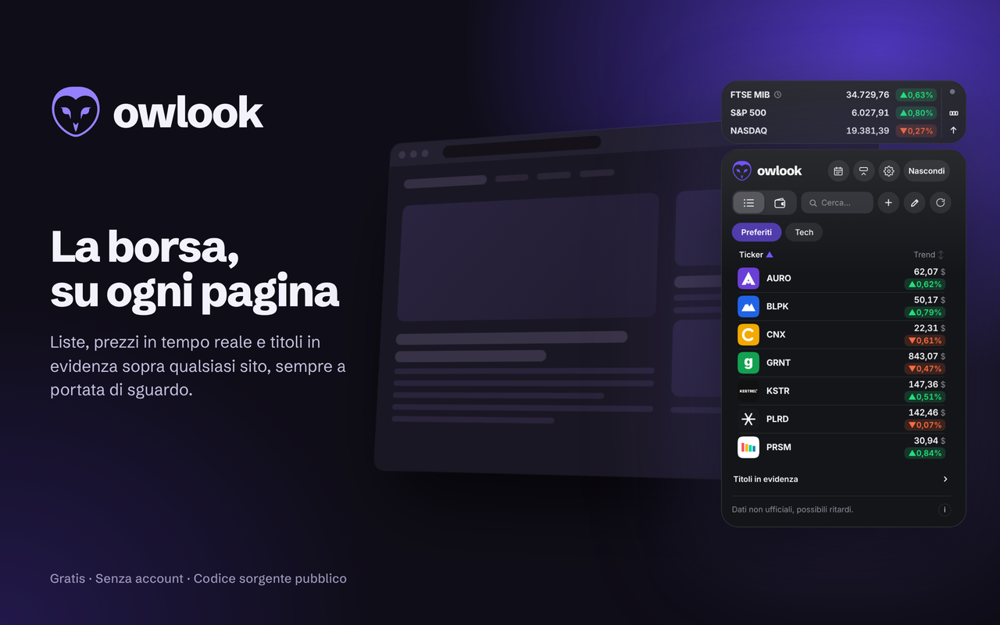
</p>
<p align="center">
  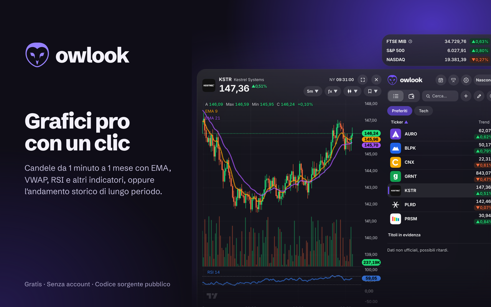
  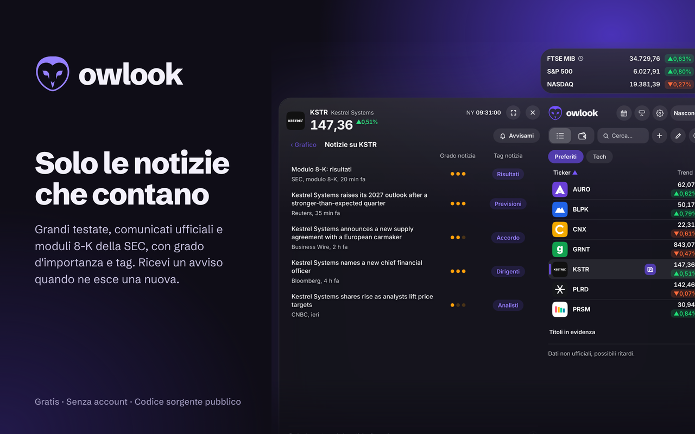
</p>
<p align="center">
  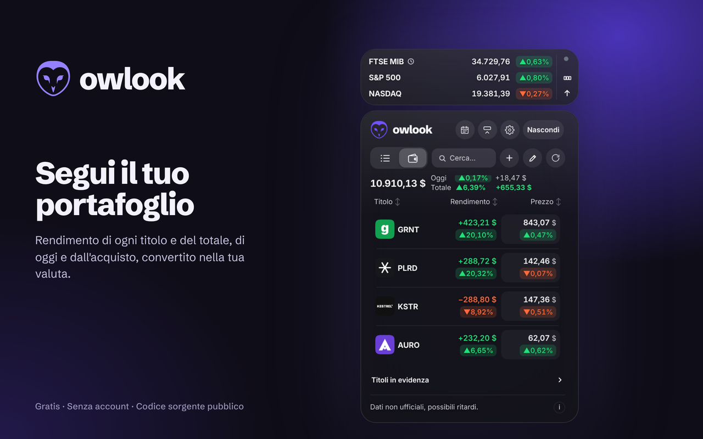
  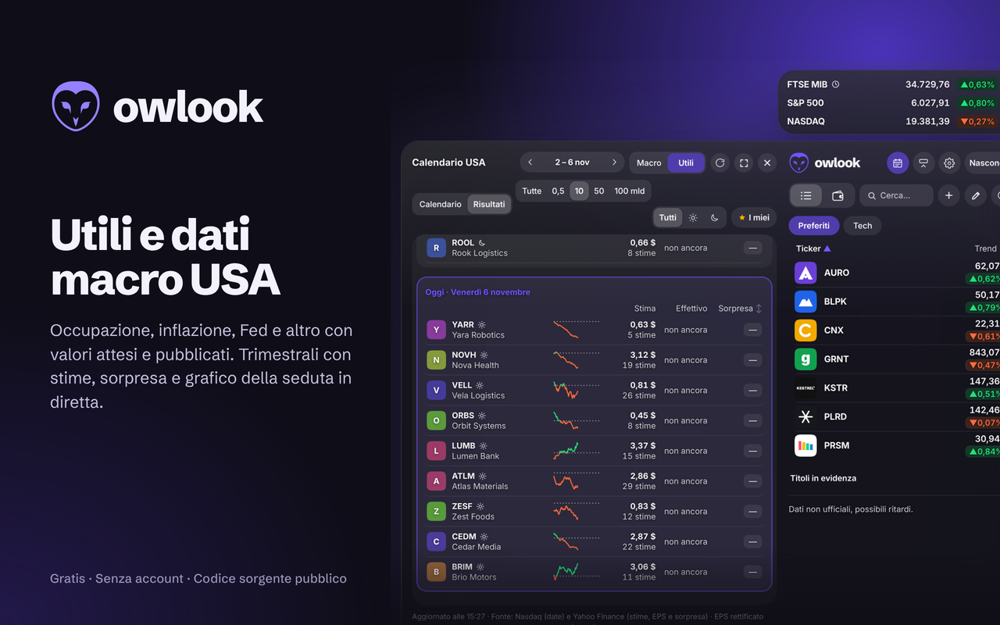
</p>
<p align="center"><sub>▶ Guarda i video sul <a href="https://owlook-quotes.github.io/owlook/">sito</a>. Immagini con titoli, loghi e dati dimostrativi.</sub></p>

> **Versione beta.** Owlook è nuova e ancora in fase di test: possono esserci errori, le fonti dei dati possono cambiare e alcune funzioni possono cambiare da una versione all'altra. Le segnalazioni sono benvenute (vedi sotto).

**Funzioni:** liste con prezzi in tempo reale, variazione dall'ultima chiusura e di oggi, loghi e ordinamento; fino a sei titoli in evidenza in alto su ogni pagina (si possono nascondere); portafoglio con quantità, prezzo medio di carico, rendimento, valore e peso sul totale, con conversione di valuta; grafici a candele con indicatori e andamento storico, con zoom ricordato e impostazioni salvabili; calendario economico USA con le attese degli analisti; calendario degli utili con la settimana a colpo d'occhio, filtri per capitalizzazione, stime, EPS effettivo e sorpresa; solo notizie importanti di ogni titolo (tasto col giornale nella riga della lista: agenzie e testate principali, comunicati ufficiali delle aziende e moduli 8-K della SEC, con tag e grado da 1 a 3) con avvisi quando esce una notizia (controllo ogni 2 minuti) e un pallino viola sul tasto quando ce ne sono di nuove; tema chiaro e scuro, effetto vetro regolabile, colori di rialzo e ribasso personalizzabili, italiano e inglese.

**Installazione dal Chrome Web Store (consigliata):** apri [Owlook sul Chrome Web Store](https://chromewebstore.google.com/detail/eejkikdiikidddfdpeejelhfcfhieelp) e premi **Aggiungi a Chrome**. Si apre una breve guida: scegli se vedere Owlook su ogni pagina o solo quando clicchi la sua icona. Si aggiorna da solo.

**Installazione manuale** (modalità sviluppatore, se preferisci non usare lo store):
1. Scarica [`Owlook-Chrome.zip`](../../releases/latest/download/Owlook-Chrome.zip) e scompattalo: ottieni la cartella `owlook`.
2. Apri la pagina delle estensioni del browser: `chrome://extensions` (Edge: `edge://extensions`, Brave: `brave://extensions`, Opera: `opera://extensions`).
3. Attiva **Modalità sviluppatore**.
4. Premi **Carica estensione non pacchettizzata** e scegli la cartella `owlook`.
5. Apri una pagina qualsiasi e premi **Alt+Maiusc+M**, oppure clicca l'icona di Owlook.

Dove il widget non può comparire (senza connessione, nuova scheda, pagine del browser) l'icona e la scorciatoia aprono Owlook nel **pannello laterale** del browser.

Lascia la cartella `owlook` dove si trova: il browser carica l'estensione da lì.

**Aggiornamento** (solo installazione manuale): scompatta la nuova versione, copia i file sopra la vecchia cartella (`owlook`), premi ⟳ sulla scheda di Owlook nella pagina delle estensioni e ricarica le pagine aperte. Liste, portafoglio e impostazioni restano.

**Browser supportati:** Chrome, Edge, Brave, Opera e Opera GX, Vivaldi, Arc e gli altri browser per computer basati su Chromium. **Non** funziona su Safari (le estensioni per Safari si pubblicano solo col programma sviluppatori a pagamento di Apple), Firefox (non ancora) e sui browser per telefono e tablet. Dove il browser non ha il pannello laterale, Owlook si apre in una piccola finestra.

**Dati e privacy:** liste, portafoglio e impostazioni restano **solo nel tuo browser**; nessun dato viene inviato all'autore, niente account né statistiche. Prezzi e grafici da Yahoo Finance (canali non ufficiali), calendario degli utili da Nasdaq (o Yahoo Finance), calendario economico dai siti ufficiali USA e previsioni da Forex Factory, loghi da Brandfetch (azioni USA: l'immagine è chiesta per ticker, senza l'indirizzo della pagina), Financial Modeling Prep, Parqet, CoinCap e flagcdn.

**Trasparenza:** tutto il codice di Owlook è nella cartella `extension/`, leggibile così come gira: niente di compresso, offuscato o scaricato da internet (l'unico file compresso è la libreria dei grafici, copia identica di `lightweight-charts@5.2.1`, con versione e impronta in `extension/lib/NOTICE-lightweight-charts.txt`). Le release le crea GitHub dal codice, con l'impronta SHA-256 dello zip e un attestato firmato: per controllare un download, `gh attestation verify Owlook-Chrome.zip -R Owlook-quotes/owlook`. [Informativa sulla privacy](https://owlook-quotes.github.io/owlook/privacy.html).

**Limiti noti:** i prezzi possono essere in ritardo e i canali di Yahoo possono smettere di funzionare; l'EPS degli utili è quello rettificato (non-GAAP) seguito dagli analisti e può differire da quello riportato dai media; alcuni loghi possono mancare.

**Segnalazioni:** apri una [issue](../../issues) indicando browser e versione, cosa hai fatto, cosa ti aspettavi e, se puoi, uno screenshot.

**Avvertenze:** non è una consulenza finanziaria; solo a scopo informativo; i dati possono essere in ritardo o sbagliati. **Nessuna garanzia, uso a tuo rischio:** Owlook è fornita "così com'è" e gratuitamente; l'autore non risponde di perdite o danni, comprese le decisioni di investimento prese in base ai dati mostrati. Verifica sempre i prezzi sul tuo broker prima di operare. Progetto indipendente, **non affiliato** a Yahoo, Nasdaq, TradingView o ad altri fornitori dei dati.

**Crediti:** codice di Owlook a **sorgente pubblico** con licenza **PolyForm Noncommercial 1.0.0** (uso, modifica e condivisione solo per scopi non commerciali; nome e logo di Owlook esclusi dalla licenza); grafici realizzati con TradingView Lightweight Charts™ © TradingView, Inc. (<https://www.tradingview.com/>), licenza Apache 2.0.
